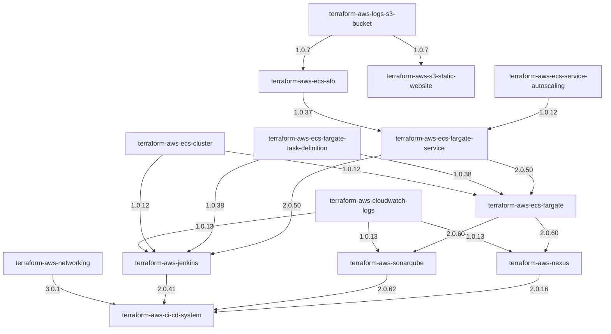

# Module dependency order

This order is derived from Terraform `module` blocks and `source` values in the checked-out module roots. A consumer should be analyzed or changed after the modules it directly composes. Modules in the same layer have no dependency on one another through the internal `cn-terraform` module sources found in this checkout and can generally be handled in parallel.

This is a **module development and task ordering guide**, not an instruction to deploy AWS infrastructure in this order. Terraform orders resources in an individual configuration from references and explicit dependencies. It is also distinct from the umbrella Git submodule pins: a module's registry version below may differ from the commit checked out under `modules/`.

## Topological layers

| Layer | Work on these modules after earlier layers |
|---|---|
| 0 — independent foundations | `terraform-aws-cloudwatch-logs`, `terraform-aws-ec2-asg`, `terraform-aws-ecs-cluster`, `terraform-aws-ecs-fargate-scheduled-task`, `terraform-aws-ecs-fargate-task-definition`, `terraform-aws-ecs-service-autoscaling`, `terraform-aws-flow-log`, `terraform-aws-logs-s3-bucket`, `terraform-aws-networking`, `terraform-aws-nomad`, `terraform-aws-route53`, `terraform-module-template` |
| 1 — S3 log bucket consumers | `terraform-aws-ecs-alb`, `terraform-aws-s3-static-website` |
| 2 — composed ECS service | `terraform-aws-ecs-fargate-service` |
| 3 — ECS Fargate and Jenkins compositions | `terraform-aws-ecs-fargate`, `terraform-aws-jenkins` |
| 4 — applications on ECS Fargate | `terraform-aws-nexus`, `terraform-aws-sonarqube` |
| 5 — aggregate CI/CD system | `terraform-aws-ci-cd-system` |

There are 20 modules in `.gitmodules`. `terraform-aws-flow-log` and `terraform-module-template` are placed in layer 0 because no internal module source dependency is declared in their module root; this does not imply that their current implementation or documentation is complete. See [MODULES_OVERVIEW.md](MODULES_OVERVIEW.md) for repository observations.

## Dependency graph

Arrows point from prerequisite to consumer. `cn-terraform` versions are the versions declared by the consumer's Terraform source; they are not the umbrella checkout's submodule SHAs.

## Direct internal module references

| Consumer | Internal prerequisites and declared registry versions |
|---|---|
| `terraform-aws-ecs-alb` | `terraform-aws-logs-s3-bucket` `1.0.7` |
| `terraform-aws-s3-static-website` | `terraform-aws-logs-s3-bucket` `1.0.7` |
| `terraform-aws-ecs-fargate-service` | `terraform-aws-ecs-alb` `1.0.37`; `terraform-aws-ecs-service-autoscaling` `1.0.12` |
| `terraform-aws-ecs-fargate` | `terraform-aws-ecs-cluster` `1.0.12`; `terraform-aws-ecs-fargate-task-definition` `1.0.38`; `terraform-aws-ecs-fargate-service` `2.0.50` |
| `terraform-aws-jenkins` | `terraform-aws-cloudwatch-logs` `1.0.13`; `terraform-aws-ecs-cluster` `1.0.12`; `terraform-aws-ecs-fargate-task-definition` `1.0.38`; `terraform-aws-ecs-fargate-service` `2.0.50` |
| `terraform-aws-nexus` | `terraform-aws-cloudwatch-logs` `1.0.13`; `terraform-aws-ecs-fargate` `2.0.60` |
| `terraform-aws-sonarqube` | `terraform-aws-cloudwatch-logs` `1.0.13`; `terraform-aws-ecs-fargate` `2.0.60` |
| `terraform-aws-ci-cd-system` | `terraform-aws-networking` `3.0.1`; `terraform-aws-jenkins` `2.0.41`; `terraform-aws-sonarqube` `2.0.62`; `terraform-aws-nexus` `2.0.16` |

No internal `cn-terraform` module sources were found in the other module roots. The graph also excludes provider requirements and third-party modules. External module sources observed include `cloudposse/ecs-container-definition/aws` `0.61.2` in the task definition, and `terraform-aws-modules/acm/aws` in Nexus (`6.3.0`) and SonarQube (`~> 6.0`). These dependencies are not separate modules in this umbrella repository.

## Suggested task workflow

For work spanning dependent modules, start at the lowest affected layer, finish and record the prerequisite interface/version changes, then proceed upward. Within a layer, independent module tasks can be parallelized. If only one consumer needs work, there is no need to modify all its prerequisites; use the graph to identify impact and verify the consumer's declared registry version and interface. Do not advance the umbrella submodule pins or publish module releases as an implied consequence of this ordering.
